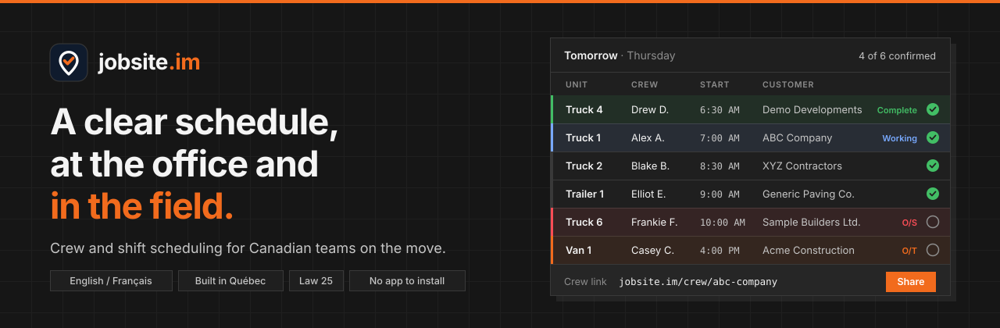

<a href="https://jobsite.im">
  <picture>
    <source media="(prefers-color-scheme: dark)" srcset="assets/banner-dark.svg">
    <source media="(prefers-color-scheme: light)" srcset="assets/banner-light.svg">
    
  </picture>
</a>

  <a href="https://jobsite.im"><b>Website</b></a> &nbsp;·&nbsp;
  <a href="https://jobsite.im/crew/demo">Live demo</a> &nbsp;·&nbsp;
  <a href="https://jobsite.im/pricing">Pricing</a> &nbsp;·&nbsp;
  <a href="https://jobsite.im/docs">Docs</a> &nbsp;·&nbsp;
  <a href="https://jobsite.im/contact">Contact</a> &nbsp;·&nbsp;
  <a href="https://jobsite.im/fr">Français</a>

---

**jobsite.im** is crew and shift scheduling for Canadian teams on the move: trades, field service, landscaping and snow removal, restaurants, trucking and retail.

The office fills one board. The crew opens one short link. Everyone sees where to go tomorrow, and a check appears beside each name once they have seen it. No app to install, no password to remember.

### How it works

| | |
|---|---|
| **1. Add your people** | Names, and the trucks, vans or stations you assign. Phone numbers are optional. |
| **2. Fill tomorrow** | One work ticket per job or shift, with the columns you already use. |
| **3. Share the link** | Once. It never changes unless you change it. |
| **4. Follow confirmations** | A check appears beside each name, so the office knows who has seen their schedule. |

### Built for the way you work

- **Field service and construction**: units, yard leave and return, job and PO numbers, directions in one tap.
- **Landscaping and snow removal**: routes, crews and equipment, ready for storm days.
- **Restaurants and retail**: stations and shifts, with shift covering between co-workers.
- **Trucking**: drivers, units and loads on one dispatch board.

### Privacy by default

Built in Québec and compliant with Law 25. No ads, no analytics, no trackers: one login cookie, nothing else. HTTPS everywhere, passwords hashed with scrypt, and every staff action is logged. Export everything in one file, or close the account and it is gone.

### Plans

| | Free | Basic | Complete | Enterprise |
|---|:---:|:---:|:---:|:---:|
| Employees | up to 5 | up to 25 | up to 75 | 75+ |
| Units and vehicles | unlimited | unlimited | unlimited | unlimited |
| Shift covering and branding | | ✓ | ✓ | ✓ |
| Support | best-effort email | email, 1 business day | chat and email | custom onboarding |
| Price (CAD / month) | **0 $** | **79 $** | **199 $** | from **499 $** |

One price per company. See [jobsite.im/pricing](https://jobsite.im/pricing) for the details.

<b>Français</b>

 

**jobsite.im** est un outil d'horaires d'équipes et de quarts de travail pour les entreprises canadiennes toujours en mouvement : métiers, services terrain, paysagement et déneigement, restaurants, camionnage et commerce de détail.

Le bureau remplit un tableau. L'équipe ouvre un seul lien court. Chacun sait où aller demain, et un crochet apparaît à côté de chaque nom dès que l'horaire a été vu. Pas d'appli, pas de mot de passe.

Conçu au Québec et conforme à la Loi 25. Aucune pub, aucune analyse, aucun traceur.

[Site web](https://jobsite.im/fr) · [Tarifs](https://jobsite.im/fr/tarifs) · [Nous joindre](https://jobsite.im/fr/contact)

---

   
  Made in Québec, Canada · <a href="https://jobsite.im/privacy">Privacy</a> · <a href="https://jobsite.im/terms">Terms</a>

